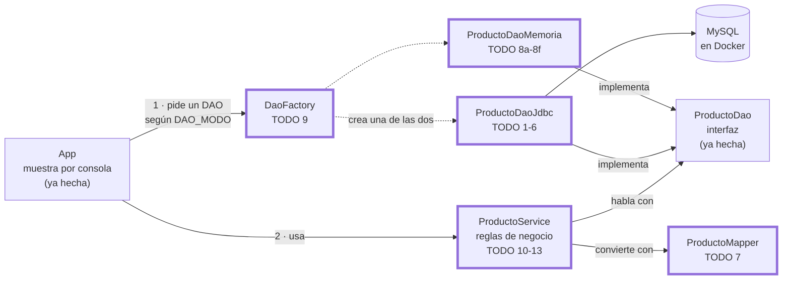
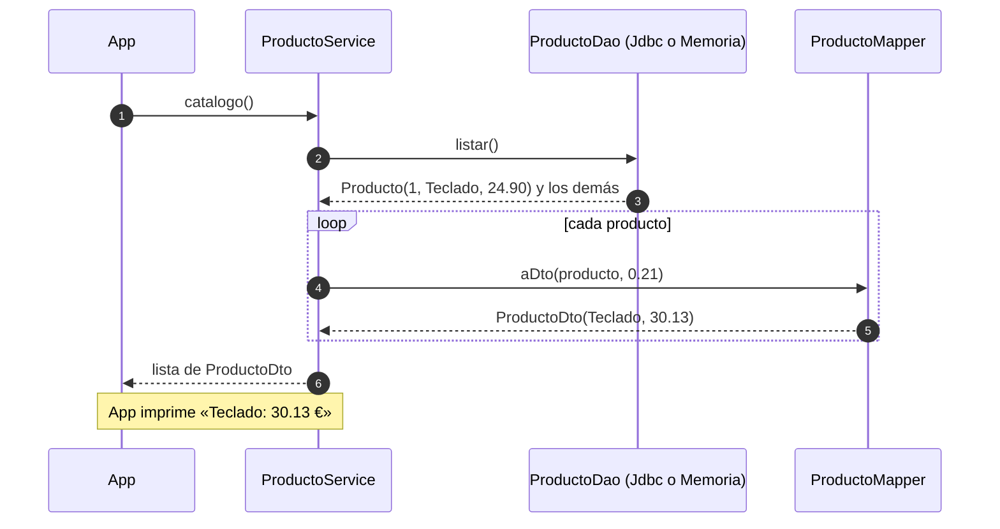
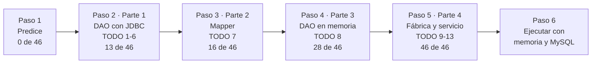
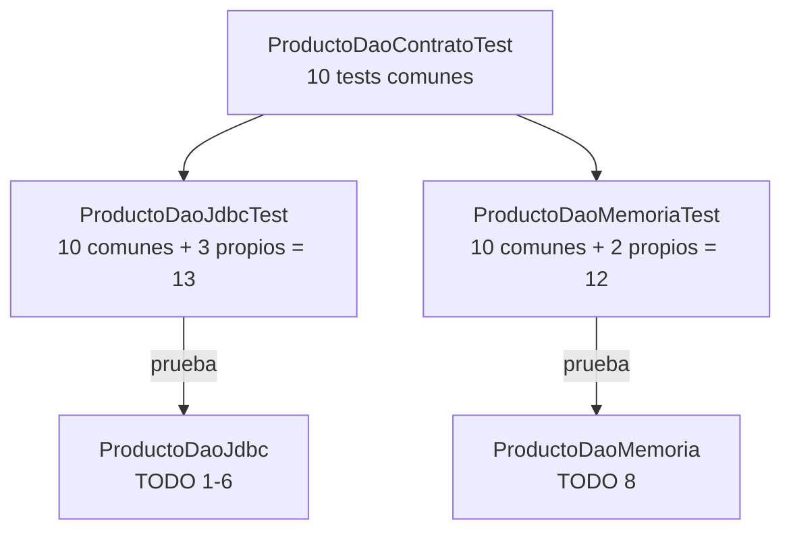
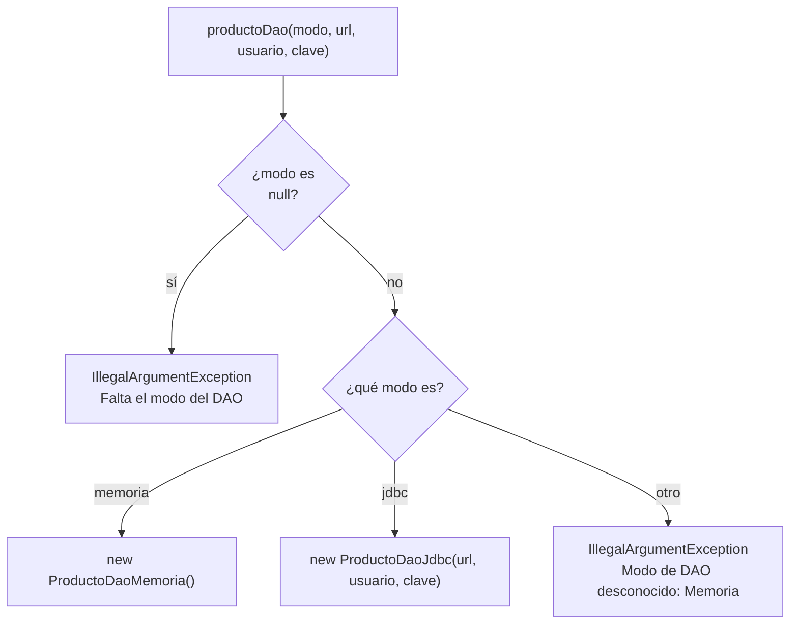
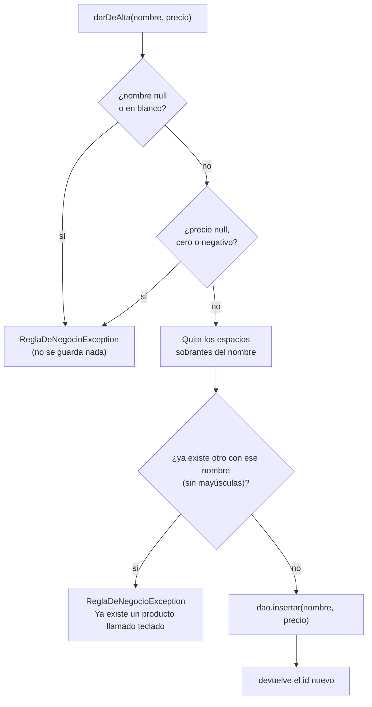
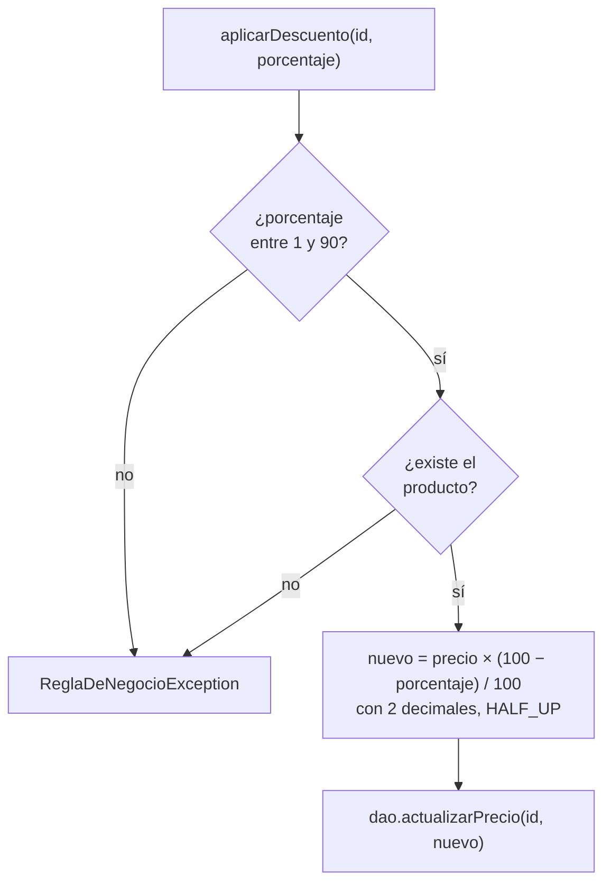
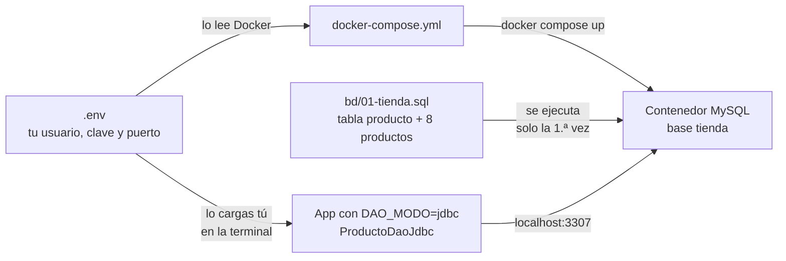
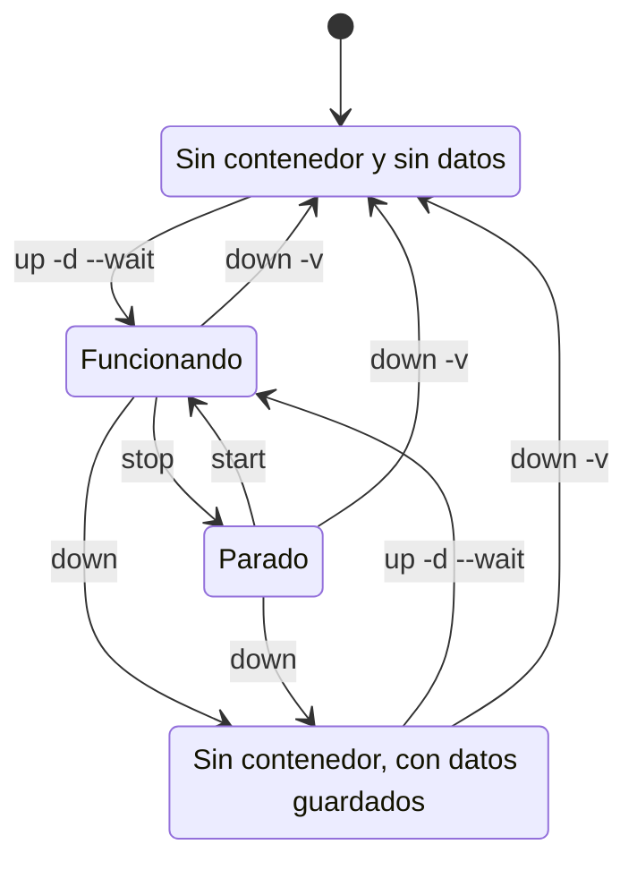

# ej05 · La tienda por capas

**Unidad:** UT3 · **CE que evidencia:** a, b, g, h · **Sesiones:** 3.2 y 3.3 · **Tiempo:** unas 3 h 30 min de trabajo (más ~45 min de lectura previa de los apuntes): ~1 h 25 en clase (3.2) + ~35 min en casa + ~1 h 30 en clase (3.3) · **Apuntes previos:** [01](https://github.com/DesWebEntornoServidor/materialClase/blob/main/unidades/ut03-patrones-diseno/apuntes/01-refactorizacion-y-patrones.md) y [02](https://github.com/DesWebEntornoServidor/materialClase/blob/main/unidades/ut03-patrones-diseno/apuntes/02-dao-y-dto.md) (el [03](https://github.com/DesWebEntornoServidor/materialClase/blob/main/unidades/ut03-patrones-diseno/apuntes/03-fabrica-y-servicio.md), antes de la clase 3.3) · **Ayuda:** [centro de ayuda de la UT3](https://github.com/DesWebEntornoServidor/materialClase/blob/main/unidades/ut03-patrones-diseno/refuerzos/README.md)

> **Cómo se usa este README.** Si una palabra no te suena, búscala en el desplegable «Palabras que vas a necesitar» (más abajo, antes de «Antes de empezar»). Es un paso a paso: hazlo **en orden, de arriba abajo**. Cada paso te dice qué vas a conseguir, qué fichero abrir, qué escribir, qué comando ejecutar y **qué deberías ver**. Si lo que ves no coincide, mira el apartado «Si algo falla» de ese paso antes de seguir. Cada TODO tiene **tres niveles de ayuda**: (1) lo que tienes que hacer, a la vista; (2) un bloque plegado «Si te atascas» con las herramientas que vas a usar; y (3) dentro de él, «Casi la solución». Abre cada nivel solo cuando lo necesites. Los *commits* (guardados de tu trabajo en Git) de cada paso son **opcionales**.

## Tu misión

La tienda de la UT2 funciona, pero sus clases (`ProductoCrud` en el ej03, `TiendaDatos` en el ej04) hacen **demasiado a la vez**: hablan con MySQL, convierten datos y mezclan las reglas. Aquí la partes en piezas pequeñas, cada una con un único trabajo (eso es una arquitectura **por capas**). Al terminar podrás cambiar MySQL por una lista en memoria **sin tocar** ni una línea de la lógica de la tienda.

Te damos un proyecto con **46 pruebas automáticas** (*tests*: programas que comprueban que tu código hace lo esperado) y las piezas a medias. Tu trabajo es escribir lo que falta, **un `TODO` cada vez**, hasta que las 46 salgan en verde.

**Figura 1 · Las piezas de la tienda y quién usa a quién.** Línea continua = «usa» o «implementa» (lo dice la etiqueta); línea punteada = «crea». Los recuadros con borde grueso son los que escribes tú (con su `TODO`); el resto ya viene hecho.



Lo importante de la figura: **`ProductoService` solo conoce la interfaz `ProductoDao`**. No sabe (ni le importa) si detrás hay MySQL o una lista en memoria. No hace falta entenderla del todo ahora: vuelve a ella cuando termines el paso 4. Las palabras que no conozcas están explicadas en el desplegable «Palabras que vas a necesitar» (más abajo).

**Figura 2 · Qué ocurre cuando `App` pide el catálogo.** Sigue los números de arriba abajo con los datos reales de la tienda.



### Qué escribes y qué ya está hecho

| Pieza | ¿La escribes tú? | Para qué sirve |
|---|---|---|
| `Producto`, `ProductoDto` | No (ya hechas) | Los datos: una fila de la tabla y lo que se enseña en pantalla |
| `ProductoDao` | No (ya hecha) | La lista de cosas que se pueden hacer con los productos (la «interfaz») |
| `AccesoDatosException`, `ReglaDeNegocioException` | No (ya hechas) | Los dos tipos de error de la tienda |
| `App` | No (ya hecha) | El programa que lo muestra todo por consola |
| `ProductoDaoJdbc` | **Sí · TODO 1 a 6** | Guarda y lee productos en MySQL con JDBC |
| `ProductoMapper` | **Sí · TODO 7** | Convierte un `Producto` en un `ProductoDto` con IVA |
| `ProductoDaoMemoria` | **Sí · TODO 8a a 8f** | Hace lo mismo que el DAO JDBC, pero en una lista en memoria |
| `DaoFactory` | **Sí · TODO 9** | Decide qué DAO se usa (JDBC o memoria) |
| `ProductoService` | **Sí · TODO 10 a 13** | Las reglas de la tienda (nombre repetido, descuentos…) |

Todas estas clases están en `src/main/java/es/dwes/ut03/`; los tests, en `src/test/java/es/dwes/ut03/`.

<details>
<summary><strong>Palabras que vas a necesitar</strong> (ábrelo antes del paso 2 y vuelve cuando una palabra no te suene)</summary>

**Repaso: lo que ya deberías saber** (Java de 1.º y UT1-UT2). Si alguna no te suena, repásala en el enlace antes de seguir.

| Palabra | Qué significa, en una frase | Dónde se vio |
|---|---|---|
| **`record`** | Una clase de **solo datos** e **inmutable** (no se puede cambiar un campo después de crearla). `new Producto(1, "Teclado", new BigDecimal("24.90"))` y se lee con `p.nombre()`. | [Glosario UT2](https://github.com/DesWebEntornoServidor/materialClase/blob/main/recursos/glosario.md#ut2--acceso-a-datos-con-jdbc) |
| **`Optional`** | Una «caja» que contiene un valor o está vacía, para no devolver `null`. `Optional.of(x)`, `Optional.empty()` y `opt.orElseThrow(...)` (saca el valor o lanza un error si está vacía). | [Glosario UT2](https://github.com/DesWebEntornoServidor/materialClase/blob/main/recursos/glosario.md#ut2--acceso-a-datos-con-jdbc) |
| **`BigDecimal`** | Número decimal **exacto**, el que se usa para el dinero. Es inmutable: `multiply`, `divide` o `setScale` devuelven **otro** número, no cambian el original. Se crea con texto: `new BigDecimal("24.90")`. Para comparar valores usa `compareTo` (`equals` distingue `2.0` de `2.00`). | Java de 1.º |
| **`Map` / `TreeMap`** | Una colección de pares clave → valor: con la clave (el `id`) obtienes el valor (el producto). `TreeMap` mantiene las claves ordenadas. | Java de 1.º |
| **Lambda** (`() -> x`) | Un trozo de código sin nombre que se ejecuta solo cuando hace falta. En `orElseThrow(() -> new X())`, la parte `new X()` solo se ejecuta si el `Optional` está vacío. | Java de 1.º |
| **Excepción no comprobada** | Un error (`RuntimeException`) que Java no te obliga a declarar con `throws` ni a capturar. | Java de 1.º |
| **Interfaz** | Una lista de métodos sin código. Quien la usa no sabe qué clase hay detrás. | Java de 1.º y [apunte 01](https://github.com/DesWebEntornoServidor/materialClase/blob/main/unidades/ut03-patrones-diseno/apuntes/01-refactorizacion-y-patrones.md) |
| **`try-with-resources`** | Un `try (...)` que **cierra solo** la conexión y las consultas al terminar. | [UT2, apunte 08](https://github.com/DesWebEntornoServidor/materialClase/blob/main/unidades/ut02-jdbc/apuntes/08-crud-con-jdbc.md) |
| **JDBC** | La API de Java para hablar con bases de datos (la que usaste en la UT2). | [UT2, apunte 07](https://github.com/DesWebEntornoServidor/materialClase/blob/main/unidades/ut02-jdbc/apuntes/07-jdbc-conexion.md) |
| **CRUD** | Las cuatro operaciones básicas sobre datos: *Create* (crear), *Read* (leer), *Update* (actualizar) y *Delete* (borrar). | [UT2, apunte 05](https://github.com/DesWebEntornoServidor/materialClase/blob/main/unidades/ut02-jdbc/apuntes/05-crud-y-guia-sql.md) |
| **Parámetro `?`** | El hueco de una consulta SQL que rellenas con un valor (`setString`, `setInt`…). Evita la inyección SQL. | [UT2, apunte 09](https://github.com/DesWebEntornoServidor/materialClase/blob/main/unidades/ut02-jdbc/apuntes/09-preparedstatement-e-inyeccion.md) |
| **Inyección SQL** | Un ataque que cuela SQL dentro de un dato (por ejemplo, un nombre) para que la base lo ejecute. Los parámetros `?` lo impiden. | [UT2, apunte 09](https://github.com/DesWebEntornoServidor/materialClase/blob/main/unidades/ut02-jdbc/apuntes/09-preparedstatement-e-inyeccion.md) |
| **Test (prueba automática)** | Código que llama a tu código y comprueba el resultado. **Verde** = pasa; **rojo** = falla. | [Apunte 01](https://github.com/DesWebEntornoServidor/materialClase/blob/main/unidades/ut03-patrones-diseno/apuntes/01-refactorizacion-y-patrones.md) |
| **Contenedor (Docker)** | Un programa (aquí, MySQL) que corre aislado en tu equipo, ya instalado y configurado, y que puedes borrar cuando ya no lo necesites. | [UT2, apunte 02](https://github.com/DesWebEntornoServidor/materialClase/blob/main/unidades/ut02-jdbc/apuntes/02-servidor-de-bd-y-contenedores.md) |
| **H2** | Una base de datos pequeña que vive en memoria; solo se usa en los tests. | Se explica aquí; solo se usa en los tests |
| **`HALF_UP`** | Redondeo de toda la vida: si está justo en la mitad, **sube**. `15.125` → `15.13`. | Se explica aquí (paso 3) |
| **Variable de entorno** | Un ajuste con nombre (por ejemplo, `DAO_MODO`) que el sistema entrega a los programas que ejecutas. | Se explica aquí (paso 6) |
| **`.env`** | Un fichero de texto con tus ajustes (usuario, clave, puerto). Es privado: **no se sube a Git**. | Se explica aquí (paso 6) |

**Palabras nuevas de esta unidad.** Se explican con calma en los [apuntes 02 y 03](https://github.com/DesWebEntornoServidor/materialClase/blob/main/unidades/ut03-patrones-diseno/apuntes/02-dao-y-dto.md) y en el [glosario de la UT3](https://github.com/DesWebEntornoServidor/materialClase/blob/main/recursos/glosario.md#ut3--patrones-de-diseño-en-el-desarrollo-web).

| Palabra | Qué significa, en una frase |
|---|---|
| **Capa** | Un grupo de clases con un único trabajo (mostrar, decidir reglas, acceder a datos). |
| **Entidad** (`Producto`) | Una fila de la tabla `producto`, tal cual: `id`, `nombre`, `precio`. |
| **DTO** (`ProductoDto`) | Los datos con la forma que necesita **quien los muestra**: `nombre` y `precioConIva`. |
| **Mapper** | Una clase que convierte una cosa en otra (aquí, `Producto` en `ProductoDto`). |
| **DAO** | «Objeto de acceso a datos»: la clase que guarda y lee productos. La **interfaz** `ProductoDao` dice *qué* se puede hacer; cada implementación decide *cómo*. |
| **Fábrica** (`DaoFactory`) | Una clase cuyo único trabajo es elegir y crear la implementación adecuada. |
| **Servicio** (`ProductoService`) | La clase donde viven las **reglas de negocio**, por ejemplo «no puede haber dos productos con el mismo nombre». |
| **Regla de negocio** | Algo que la tienda exige, sin importar cómo se guarde ni cómo se muestre. |
| **Test de contrato** | El mismo test que se ejecuta contra dos implementaciones (JDBC y memoria) para demostrar que se comportan igual. |
| **Colación** | La regla que decide cuándo MySQL considera iguales dos textos (por ejemplo, si `a` y `A` lo son). |
| **Atómico** | Que se hace entero, sin que otra operación pueda colarse a medias. |

</details>

## Antes de empezar

Haz estas comprobaciones **una sola vez**. Si alguna no sale como se indica, resuélvela ahora y no sigas.

### A · Descarga y descomprime

1. Descarga [ejercicios-ut03.zip](https://github.com/DesWebEntornoServidor/materialClase/blob/main/descargas/ejercicios-ut03.zip).
2. Descomprímelo **fuera** de la carpeta `materialClase` (por ejemplo, en tu carpeta de proyectos).
3. Abre una terminal **dentro de la carpeta `ej05-tienda-por-capas`**.

> **Los enlaces de este README** (apuntes, ayuda, guía del JDK) funcionan cuando lo abres dentro de la carpeta `materialClase` del curso o en su web. Si lo lees desde la copia descomprimida y un enlace no abre, búscalo en la carpeta o en la web del curso.

> **Qué es «una terminal dentro de la carpeta».** Una ventana de texto donde escribes órdenes. En VS Code: *Archivo → Abrir carpeta* con la carpeta del ejercicio y después *Terminal → Nueva terminal*.

Comprueba que estás en el sitio correcto:

```bash
ls
```

```powershell
dir
```

**Deberías ver**, entre otros, estos nombres: `README.md`, `pom.xml`, `src`, `docker-compose.yml`, `bd`, `mvnw` y `mvnw.cmd`. (Los ficheros que empiezan por punto, como `.env.example`, no salen con `ls` a secas; es normal.)

### B · Comprueba Java

```bash
java -version
javac -version
```

**Deberías ver** una versión **21** (o superior) en las dos, y la **misma** en las dos. Si `javac` no existe o muestra otra versión que `java`, instala o arregla el JDK con la guía [Instalar el JDK 21](https://github.com/DesWebEntornoServidor/materialClase/blob/main/docs/entorno/README.md#instalar-el-jdk-21).

### C · Comprueba Maven

**Maven** es la herramienta que compila el proyecto y ejecuta los tests. No tienes que instalarla: el proyecto trae `mvnw` (el *Maven Wrapper*), un pequeño script que descarga la versión correcta la primera vez.

```bash
./mvnw -v
```

```powershell
.\mvnw.cmd -v
```

**Deberías ver** una línea que empieza por `Apache Maven 3.` y otra con `Java version: 21` (o superior). La primera vez tarda un poco, porque descarga Maven (necesitas conexión a internet). Si falla, lo más habitual es que no haya conexión (o que un proxy la bloquee) o que `JAVA_HOME` apunte a otro JDK: copia el mensaje completo, repasa la [guía del JDK](https://github.com/DesWebEntornoServidor/materialClase/blob/main/docs/entorno/README.md#instalar-el-jdk-21) o pregunta en clase. En Linux y macOS, `Permission denied` se arregla con `chmod +x mvnw`.

> **Windows (PowerShell):** en todos los comandos de este README, cambia `./mvnw` por `.\mvnw.cmd`. En Linux y macOS usa `./mvnw` tal cual.

### D · Docker (solo para el paso 6, pero conviene dejarlo listo)

Docker es lo que te permite **tener la base de datos con todos sus datos en menos de un minuto**, sin instalar MySQL ni crear tablas a mano. No lo necesitas hasta el paso 6; los tests no lo usan.

```bash
docker --version
docker compose version
```

**Deberías ver** una versión en cada línea. Si no tienes Docker, sigue el [paso 8 de la guía de entorno](https://github.com/DesWebEntornoServidor/materialClase/blob/main/docs/entorno/guia-plantilla-vscode.md#paso-8--instala-docker). Si no puedes instalarlo, avísalo en clase: los pasos 1 a 5 y el 6.1 funcionan sin él.

### E · Lo que ya deberías saber y lecturas previas

Este ejercicio **parte de** lo que ya has visto: **Java de 1.º** (clases, interfaces, excepciones, colecciones, `record`, `Optional` y lambdas sencillas) y la **UT1-UT2** (SQL, JDBC con `PreparedStatement` y MySQL en Docker). Si una palabra no te suena, tienes un repaso de una línea, con enlace, en la primera tabla del desplegable «Palabras que vas a necesitar».

- [ ] Has leído (unos 30 min, antes de clase y fuera de los tiempos de la tabla) los apuntes [01](https://github.com/DesWebEntornoServidor/materialClase/blob/main/unidades/ut03-patrones-diseno/apuntes/01-refactorizacion-y-patrones.md) y [02](https://github.com/DesWebEntornoServidor/materialClase/blob/main/unidades/ut03-patrones-diseno/apuntes/02-dao-y-dto.md). El [03](https://github.com/DesWebEntornoServidor/materialClase/blob/main/unidades/ut03-patrones-diseno/apuntes/03-fabrica-y-servicio.md) (unos 15 min más) hace falta antes de la clase 3.3, para la fábrica y el servicio.
- [ ] Tienes a mano tu `ProductoCrud` del ej03: la parte 1 es convertirlo. Si no recuerdas cómo era un método JDBC, repasa el [apunte 08 de la UT2](https://github.com/DesWebEntornoServidor/materialClase/blob/main/unidades/ut02-jdbc/apuntes/08-crud-con-jdbc.md).

## La ruta, de un vistazo

**Figura 3 · El camino completo y cuántos tests deberías tener en verde al terminar cada parte.** Los números están comprobados con la solución de referencia.



| Paso | Dónde se hace | Tiempo orientativo |
|---|---|---|
| Preparación (A a E) | Mejor antes de la clase 3.2 | 15 min (si el entorno ya está instalado) |
| 1 · Predice | Clase 3.2 | 5 min |
| 2 · Parte 1: DAO JDBC | Clase 3.2 | 50 min |
| 3 · Parte 2: mapper | Clase 3.2 (o en casa) | 15 min |
| 4 · Parte 3: DAO en memoria | Casa | 35 min (hasta 50 si `Map` y `Optional` te son nuevos) |
| 5 · Parte 4: fábrica y servicio | Clase 3.3 (lee antes el apunte 03) | 70 min (fábrica 10 + servicio 60) |
| 6 · Ejecutarlo con Docker | Clase 3.3 | 20 min |

La primera vez que ejecutes Maven tardará unos minutos más, porque descarga las dependencias.

> **Qué es nuevo y qué es repetición.** La parte 1 es el CRUD que ya escribiste en la UT2, ahora detrás de una interfaz y con los errores envueltos. Lo nuevo de verdad son el **mapper**, el **DAO en memoria**, la **fábrica** y el **servicio**. Si en clase vais justos, el paso 6.2 (Docker) puede quedar para casa.

---

## Paso 1 · Predice (5 min)

**Qué vas a conseguir:** ver cómo se ve el punto de partida y leer tu primer mensaje de test.

1. **Antes de ejecutar nada, apunta en un papel** dos cosas: (a) cuántos de los 46 tests crees que pasan ahora mismo y (b) qué crees que dirá el mensaje de error del primer test que falle.
2. Ejecuta los tests **sin tocar nada**:

```bash
./mvnw test
```

3. Mira el final de la salida. **Deberías ver** algo como esto:

```text
[ERROR] Tests run: 46, Failures: 4, Errors: 42, Skipped: 0
[INFO] BUILD FAILURE
```

No pasa ninguno: es lo esperado, porque las piezas están a medias. Compara con tu apunte (a).

> **Fallo y error.** Un *fallo* (`Failure`) es que el test comprobó algo y no coincidió; un *error* (`Error`) es que tu código lanzó una excepción que nadie esperaba. Para ti son lo mismo: ese test aún no pasa.

4. Busca más arriba una línea como esta, léela despacio y compárala con tu apunte (b):

```text
[ERROR]   ProductoDaoJdbcTest>ProductoDaoContratoTest.listarDevuelveTodosLosProductosOrdenadosPorId:39 » UnsupportedOperation TODO 1
```

Se lee así: «el test `listarDevuelveTodosLosProductosOrdenadosPorId` falló con `UnsupportedOperation TODO 1`». Es el esqueleto avisándote: **ese método todavía no está escrito**, es el `TODO 1`. No es un error tuyo; es tu lista de tareas. Para ver todos los pendientes de golpe, en VS Code pulsa `Ctrl+Shift+F` y busca `TODO`.

> **Verás muchas veces `TODO 8d`.** Los tests del DAO en memoria y del servicio preparan sus datos llamando a `insertar` del DAO en memoria (el TODO 8d). Mientras no lo escribas, fallan **todos** con ese mensaje. No te asustes: es una sola pieza la que los bloquea.

**Si algo falla:** si ves `Permission denied` al ejecutar `./mvnw` (Linux/macOS), ejecuta `chmod +x mvnw` y repite. La [guía de diagnóstico](https://github.com/DesWebEntornoServidor/materialClase/blob/main/unidades/ut03-patrones-diseno/refuerzos/04-diagnostico-de-errores.md) explica cada mensaje que vas a encontrar.

---

## Paso 2 · Parte 1: el DAO con JDBC (TODO 1 a 6) — 50 min

**Qué vas a conseguir:** que `ProductoDaoJdbc` lea y escriba productos en la base de datos. Es tu `ProductoCrud` de la UT2, pero implementando la interfaz `ProductoDao`.

**Tests que lo vigilan:** `ProductoDaoJdbcTest` (13). Al terminar la parte, tendrás **13 de 46** en verde.

### 2.1 · Qué trae hecho el fichero

Abre `src/main/java/es/dwes/ut03/ProductoDaoJdbc.java`. Antes de los `TODO` ya tienes:

- `url`, `usuario` y `clave`: los datos de conexión que recibe el constructor.
- `conectar()`: abre una conexión nueva con esos datos. **Lanza `SQLException`**, así que la usarás dentro de un `try`.
- `aProducto(ResultSet rs)`: convierte la fila actual del resultado en un `Producto`. Te ahorra repetirlo en cada método.

### 2.2 · Tres reglas que cambian respecto al ej03

1. **Los métodos no declaran `throws SQLException`.** Si salta una, la **envuelves** y la relanzas como `AccesoDatosException`, **pasando la original como causa**:

   ```java
   } catch (SQLException e) {
       throw new AccesoDatosException("No se pudo listar los productos", e);   // la «, e» es la causa
   }
   ```

   Sin la causa pierdes la pista de qué falló de verdad. Nunca dejes el `catch` vacío ni un `printStackTrace`.

2. **`buscarPorId` devuelve `Optional<Producto>`**, no `null`: `Optional.of(...)` si hay fila y `Optional.empty()` si no.
3. **`actualizarPrecio` y `eliminar` devuelven `boolean`**: `true` si la fila existía (la consulta afectó a una fila) y `false` si no. `executeUpdate()` te devuelve cuántas filas cambió.

Y se mantienen dos reglas de la UT2: **`try-with-resources`** para cerrar recursos y **parámetros `?`** (nunca concatenes texto en el SQL: hay un test de inyección SQL).

### 2.3 · La receta (sirve para los seis métodos)

Cada método sigue los mismos cinco pasos, dentro de un `try-with-resources`:

1. Abre la conexión: `Connection c = conectar()`.
2. Prepara la consulta: `c.prepareStatement("…SQL con ?…")`.
3. Rellena los `?` (`ps.setInt(1, id)`, `ps.setString(1, nombre)`, `ps.setBigDecimal(2, precio)`…). El primer `?` es el 1.
4. Ejecútala: `executeQuery()` para un `SELECT`, `executeUpdate()` para `INSERT`, `UPDATE` y `DELETE`.
5. Convierte el resultado y devuélvelo. Y en el `catch (SQLException e)`, envuelve.

> **Imports.** Si el editor subraya un nombre en rojo (por ejemplo `PreparedStatement`, `Statement` o `ArrayList`), falta su `import`: en VS Code pulsa `Ctrl+.` y elige *Import*, o escríbelo tú (`import java.sql.PreparedStatement;`). Pasará también con `RoundingMode` en el mapper.

<details>
<summary><strong>Forma del método</strong> (el esqueleto, sin rellenar)</summary>

```java
try (Connection c = conectar();
     PreparedStatement ps = c.prepareStatement("… tu SQL con ? …")) {
    // 1. rellena los ? con ps.setInt(1, …), ps.setString(1, …)…
    // 2. ejecuta (executeQuery o executeUpdate) y convierte el resultado
} catch (SQLException e) {
    throw new AccesoDatosException("mensaje claro", e);
}
```

En un `SELECT`, el `ResultSet` también se abre dentro del paréntesis del `try`. Si quieres ver un método completo de otra tabla, mira `listar()` en la sección «Read · SELECT» del [apunte 08 de la UT2](https://github.com/DesWebEntornoServidor/materialClase/blob/main/unidades/ut02-jdbc/apuntes/08-crud-con-jdbc.md#read--select).

</details>

### 2.4 · Los seis TODO, uno a uno

Hazlos **en este orden**. Después de cada uno, ejecuta el comando y comprueba que sube el número de tests en verde.

| TODO | Método | Qué hace | Comando | Verde cuando… |
|---|---|---|---|---|
| 1 | `listar` | Devuelve todos los productos, ordenados por `id` | `./mvnw test -Dtest='ProductoDaoJdbcTest#listar*'` | `Tests run: 1`, sin fallos |
| 2 | `buscarPorId` | Devuelve el producto con ese `id`, o vacío si no existe | `./mvnw test -Dtest='ProductoDaoJdbcTest#buscarPorId*'` | `Tests run: 2` |
| 3 | `buscarPorNombre` | Devuelve los productos con ese nombre exacto (con un parámetro `?`, nunca concatenando) | `./mvnw test -Dtest='ProductoDaoJdbcTest#buscarPorNombre*'` | `Tests run: 3` |
| 4 | `insertar` | Guarda un producto nuevo y devuelve el `id` que le asigna la base de datos | `./mvnw test -Dtest='ProductoDaoJdbcTest#insertar*'` | `Tests run: 1` |
| 5 | `actualizarPrecio` | Cambia el precio; `true` si el producto existía | `./mvnw test -Dtest='ProductoDaoJdbcTest#actualizarPrecio*'` | `Tests run: 2` |
| 6 | `eliminar` | Borra el producto; `true` si existía | `./mvnw test -Dtest='ProductoDaoJdbcTest#eliminar*'` | `Tests run: 2` |

> **Qué significa `-Dtest='…#listar*'`.** «Ejecuta solo los tests de esa clase cuyo nombre empiece por `listar`». El `*` es un comodín. Pon el valor entre comillas simples. Sirve para ir avanzando sin ver los fallos de lo que aún no has escrito.

Quedan dos tests propios de esta clase, que se cumplen con el `catch` que ya has escrito:

| Test | Se cumple con… | Comando |
|---|---|---|
| El precio negativo llega como `AccesoDatosException` con la `SQLException` como causa | El `catch` del TODO 4 (`insertar`) | `./mvnw test -Dtest='ProductoDaoJdbcTest#unPrecioNegativo*'` |
| Si no hay base de datos, también se lanza `AccesoDatosException` | El `catch` de cualquier método (lo prueba con `listar`) | `./mvnw test -Dtest='ProductoDaoJdbcTest#siLaBaseDeDatos*'` |

<details>
<summary><strong>Si te atascas</strong> · qué vas a usar en cada TODO</summary>

| TODO | Qué vas a usar |
|---|---|
| 1 | `executeQuery()`, recorrer el resultado y `aProducto(rs)` |
| 2 | `setInt` y `Optional` |
| 3 | `setString`; incluye el test de inyección SQL |
| 4 | `RETURN_GENERATED_KEYS` y las claves generadas |
| 5 | `executeUpdate()` |
| 6 | `executeUpdate()` |

El SQL de cada método está en el comentario del propio `TODO`, dentro del código.

<details>
<summary>Casi la solución</summary>

- **TODO 1:** crea una lista vacía, recorre el resultado fila a fila convirtiendo cada una con `aProducto(rs)` y devuélvela. Si no hay filas, devuelves la lista vacía, nunca `null`.
- **TODO 2:** si el resultado tiene una fila, devuelve el producto dentro de un `Optional`; si no, un `Optional` vacío.
- **TODO 3:** igual que el 1, pero con un `?` que rellenas con el nombre. El texto del usuario es siempre un dato, nunca parte del SQL.
- **TODO 4:** al preparar la consulta pide que devuelva las claves generadas; tras ejecutarla, abre esas claves, comprueba con `next()` que hay una y lee la primera columna.
- **TODO 5 y 6:** `executeUpdate()` devuelve cuántas filas ha cambiado; el método devuelve `true` si fue una.
- ¿No recuerdas la forma de un método JDBC? Abre tu `ProductoCrud` del ej03 o el [apunte 08 de la UT2](https://github.com/DesWebEntornoServidor/materialClase/blob/main/unidades/ut02-jdbc/apuntes/08-crud-con-jdbc.md).

</details>

</details>

Al terminar los seis, ejecuta toda la clase:

```bash
./mvnw test -Dtest=ProductoDaoJdbcTest
```

**Deberías ver:**

```text
[INFO] Tests run: 13, Failures: 0, Errors: 0, Skipped: 0
[INFO] BUILD SUCCESS
```

Si te sale un `Caused by:` en un fallo, **baja hasta él**: ahí está la `SQLException` original con el motivo real.

**Mini-reto (2 min).** En el `catch` de `insertar`, cambia la `e` por `null` (`throw new AccesoDatosException("…", null)`) y ejecuta `./mvnw test -Dtest='ProductoDaoJdbcTest#unPrecioNegativo*'`. ¿Qué test falla y qué dice? Después, vuelve a poner la `e`.

<details>
<summary>Respuesta</summary>

Falla `unPrecioNegativo…` con `La causa original debe conservarse ==> expected: <true> but was: <false>`: sin la `e`, la `SQLException` original se pierde y ya no sabrás por qué falló.

</details>

### 2.5 · ¿Por qué 13 tests y no 6?

**Figura 4 · Un solo test escrito una vez, dos implementaciones.** 10 de los 13 tests son «de contrato»: los mismos para el DAO JDBC y para el DAO en memoria. Los tests JDBC usan una base **H2 en memoria** (una base de datos pequeña solo para pruebas: no necesitan MySQL ni Docker). Ojo: H2 imita a MySQL pero **no es** MySQL; la prueba con MySQL real es el paso 6.2. Un ejemplo real de diferencia es la *colación* de la columna `nombre` (*colación*: la regla que decide cuándo MySQL considera iguales dos textos, por ejemplo `a` y `A`; mira «Lo que se ha simplificado»).



Los 3 tests propios del DAO JDBC son los que acabas de ver: el de inyección SQL (TODO 3), el del precio negativo y el de la base no disponible.

### Si algo falla

| Síntoma | Qué hacer |
|---|---|
| `UnsupportedOperation TODO n` en el test que acabas de trabajar | Ese método aún tiene el `throw` del esqueleto. Bórralo y escribe tu código. |
| `Expected AccesoDatosException … but UnsupportedOperationException` | Todavía no has escrito ese método (o su `catch`). |
| `expected: <3> but was: <0>` en un test de listar | Tu consulta no devuelve filas, o no recorres el resultado. |
| Otros mensajes | [Guía de diagnóstico](https://github.com/DesWebEntornoServidor/materialClase/blob/main/unidades/ut03-patrones-diseno/refuerzos/04-diagnostico-de-errores.md) y [cómo leer los tests de contrato](https://github.com/DesWebEntornoServidor/materialClase/blob/main/unidades/ut03-patrones-diseno/refuerzos/05-leer-tests-de-contrato-y-depurar.md). |

**Guarda tu progreso** (opcional): `git add . && git commit -m "feat: ProductoDaoJdbc (TODO 1-6)"`.

---

## Paso 3 · Parte 2: el mapper (TODO 7) — 15 min

**Qué vas a conseguir:** que `ProductoMapper.aDto` convierta un `Producto` (con el precio sin IVA) en un `ProductoDto` (con el precio con IVA). Tests: `ProductoMapperTest` (3).

Abre `ProductoMapper.java`. El método recibe un `Producto` y el tipo de IVA como fracción (`0.21` es el 21 %). Debes devolver un `ProductoDto` con el mismo nombre y este precio:

```text
precioConIva = precio × (1 + tipoIva)   →  con 2 decimales y redondeo HALF_UP
```

**Ejemplo con los datos de la tienda** (IVA 0.21):

| Producto | Cálculo | Resultado sin redondear | Con `HALF_UP` y 2 decimales |
|---|---|---|---|
| Teclado | 24.90 × 1.21 | 30.129 | **30.13** |
| Ratón | 12.50 × 1.21 | 15.125 | **15.13** (justo la mitad: sube) |

Los precios son `BigDecimal` (nunca `double` para dinero) y, recuerda, **inmutables**: cada operación devuelve un número nuevo que tienes que usar. Los campos de un `record` se leen con `producto.nombre()` y `producto.precio()`.

<details>
<summary><strong>Si te atascas</strong> · qué vas a usar en el mapper</summary>

| TODO | Qué vas a usar |
|---|---|
| 7 | `BigDecimal` (`add`, `multiply` y `setScale`), `RoundingMode` y el constructor de `ProductoDto` |

<details>
<summary>Casi la solución</summary>

Suma 1 al tipo de IVA (para obtener 1.21), multiplica el precio por ese número y fija 2 decimales con redondeo `HALF_UP`. Después crea el `ProductoDto` con el mismo nombre y ese precio.

</details>

</details>

```bash
./mvnw test -Dtest=ProductoMapperTest
```

**Deberías ver:**

```text
[INFO] Tests run: 3, Failures: 0, Errors: 0, Skipped: 0
[INFO] BUILD SUCCESS
```

**Si algo falla:** `Se esperaba 15.13 pero llegó 15.1250` significa que falta `setScale(2, …)`; `llegó 15.12` significa que el redondeo no es `HALF_UP`.

> **Punto de control.** Con las partes 1 y 2 hechas, `./mvnw test` debe decir `Tests run: 46` con **30 fallos y errores** (es decir, **16 en verde**). Los que quedan en rojo son los de las partes 3 y 4. Si te salen más en rojo, repasa las partes 1 y 2.

**Guarda tu progreso** (opcional): `git add . && git commit -m "feat: ProductoMapper con IVA (TODO 7)"`.

---

## Paso 4 · Parte 3: el DAO en memoria (TODO 8a a 8f) — 35 min (hasta 50 si `Map` y `Optional` te son nuevos)

Este paso está pensado para hacerlo **en casa**, con calma. La fábrica (TODO 9) la harás en la clase 3.3, junto con el servicio.

**Qué vas a conseguir:** un DAO que cumple **la misma interfaz** pero guarda los productos en un mapa en vez de en MySQL. Sirve para probar la lógica de la tienda sin ningún servidor. Debe pasar **los mismos 10 tests de contrato** que el DAO JDBC (figura 4).

Abre `ProductoDaoMemoria.java`. Ya tiene dos campos: `productos` (un `TreeMap` que guarda cada producto con su `id` como clave y los mantiene ordenados por `id`, como el `ORDER BY id` de SQL) y `siguienteId` (el próximo id libre, empieza en 1).

> **Empieza por el 8d (`insertar`).** Todos los tests de esta clase llaman a `insertar` para preparar sus datos. Si no lo escribes primero, los 12 fallarán con `TODO 8d` aunque los demás métodos estén bien. Orden recomendado: **8d, 8a, 8b, 8c, 8e, 8f**.

| TODO | Método | Qué hace |
|---|---|---|
| 8d | `insertar` | Asigna el id actual, lo incrementa, guarda el producto y devuelve el id |
| 8a | `listar` | Devuelve **una copia** de los productos (para que quien llama no pueda tocar tu mapa) |
| 8b | `buscarPorId` | `Optional` con el producto, o vacío si no existe |
| 8c | `buscarPorNombre` | Los productos con **exactamente** ese nombre, en orden de id |
| 8e | `actualizarPrecio` | Cambia el precio; `false` si no existe |
| 8f | `eliminar` | Borra; `true` si existía |

Hazlos **en el orden recomendado** (8d, 8a, 8b, 8c, 8e, 8f) y, después de cada uno, ejecuta su comando. Ojo: casi todos los tests de esta clase usan varios métodos a la vez, así que **el 8d no se nota solo**: hasta escribir el 8a, no pasa ninguno.

| Acabas de escribir | Comando | Deberías ver | En verde en toda la clase |
|---|---|---|---|
| 8d `insertar` | `./mvnw test -Dtest=ProductoDaoMemoriaTest` | los 12 siguen en rojo (es normal: ahora fallan por `TODO 8a` y siguientes) | 0 de 12 |
| 8a `listar` | `./mvnw test -Dtest='ProductoDaoMemoriaTest#listar*'` | `Tests run: 1` | 2 de 12 (también pasa `#laLista*`, el test de la copia) |
| 8b `buscarPorId` | `./mvnw test -Dtest='ProductoDaoMemoriaTest#buscarPorId*'` | `Tests run: 2` | 5 de 12 (ya pasa también `#insertar*`) |
| 8c `buscarPorNombre` | `./mvnw test -Dtest='ProductoDaoMemoriaTest#buscarPorNombre*'` | `Tests run: 2` | 7 de 12 |
| 8e `actualizarPrecio` | `./mvnw test -Dtest='ProductoDaoMemoriaTest#actualizarPrecio*'` | `Tests run: 2` | 9 de 12 |
| 8f `eliminar` | `./mvnw test -Dtest='ProductoDaoMemoriaTest#eliminar*'` | `Tests run: 2` | 12 de 12 (ya pasa también `#losIds*`, que borra un producto) |

<details>
<summary><strong>Si te atascas</strong> · qué vas a usar en la parte 3</summary>

| TODO | Qué vas a usar |
|---|---|
| 8d | `siguienteId`, `productos.put(...)` |
| 8a | `productos.values()` y una nueva `ArrayList` |
| 8b | `productos.get(id)` y `Optional` |
| 8c | recorrer `productos.values()` y comparar nombres |
| 8e | los `record` son **inmutables**: hay que sustituir el producto |
| 8f | `productos.remove(id)` |

<details>
<summary>Casi la solución</summary>

- **8d:** guarda el valor actual de `siguienteId` en una variable, súbelo en uno y usa esa variable como `id` del nuevo `Producto` y como clave del mapa. Devuelve el `id`. (El id sale de un contador que solo sube, no del tamaño del mapa.)
- **8a:** devuelve una lista nueva con los productos del mapa (una copia), para que quien llama no pueda tocar tu mapa.
- **8b:** busca el producto por su id en el mapa y devuélvelo dentro de un `Optional` (vacío si no está).
- **8c:** recorre los productos y quédate con los que tengan exactamente ese nombre, en el orden en que están.
- **8e:** si el id no está en el mapa, devuelve `false`. Si está, recuerda que un `record` no se puede modificar: crea otro con el mismo id y nombre y el nuevo precio, guárdalo con la misma clave y devuelve `true`.
- **8f:** quitar un elemento del mapa devuelve el valor borrado, o `null` si no estaba: con eso sabes qué devolver.

</details>

</details>

```bash
./mvnw test -Dtest=ProductoDaoMemoriaTest
```

**Deberías ver:** `Tests run: 12, Failures: 0, Errors: 0` (los 10 de contrato más 2 propios: la lista devuelta es una copia y los ids no se reutilizan tras borrar).

### Si algo falla

| Mensaje (real) | Qué significa | Qué hacer |
|---|---|---|
| `UnsupportedOperation TODO 8d` en casi todos los tests de memoria | Aún no has escrito `insertar`, y todos preparan sus datos con él | Escribe primero el 8d |
| `expected: <4> but was: <3>` en `losIdsNoSeReutilizanTrasBorrar` | Calculas el id nuevo a partir del tamaño del mapa, y al borrar se repite | Usa el contador `siguienteId`, que solo sube |
| `expected: <3> but was: <0>` en un test de listar | Tu DAO no guarda lo que inserta, o `listar` devuelve una lista vacía | Revisa `insertar` (8d) y `listar` (8a) |

### Punto de control

```bash
./mvnw test
```

Deberías tener **28 en verde y 18 en rojo** (los 4 de la fábrica y los 14 del servicio, que harás en la clase 3.3).

**Guarda tu progreso** (opcional): `git add . && git commit -m "feat: ProductoDaoMemoria (TODO 8)"`.

---

## Paso 5 · Parte 4: fábrica y servicio (TODO 9 a 13) — 70 min

Antes de empezar, lee el [apunte 03](https://github.com/DesWebEntornoServidor/materialClase/blob/main/unidades/ut03-patrones-diseno/apuntes/03-fabrica-y-servicio.md) si no lo has hecho en casa.

### 5.0 · La fábrica: `DaoFactory` (TODO 9) — 10 min

**Qué vas a conseguir:** que `App` pida un DAO sin saber cuál recibe. La fábrica lee el **modo** (`"memoria"` o `"jdbc"`) y crea el DAO correspondiente.

<details>
<summary><strong>Comprueba tu diseño</strong> · ábrelo cuando hayas intentado este TODO</summary>

**Figura 5 · Qué decide `DaoFactory.productoDao(modo, …)`.**



</details>

- El modo se escribe en **minúsculas**: `"Memoria"` es un modo desconocido.
- El mensaje del error por modo desconocido **debe nombrar el modo** que llegó (un test lo comprueba).
- Tienes un ejemplo de fábrica en el [apunte 03](https://github.com/DesWebEntornoServidor/materialClase/blob/main/unidades/ut03-patrones-diseno/apuntes/03-fabrica-y-servicio.md). Hay un test para el caso en que el modo es `null`: piensa qué haría ese ejemplo si le llegara.

<details>
<summary><strong>Si te atascas</strong> · qué vas a usar en el TODO 9</summary>

| TODO | Qué vas a usar |
|---|---|
| 9 | un `switch` sobre el texto del modo, `new ProductoDaoMemoria()`, `new ProductoDaoJdbc(url, usuario, clave)` e `IllegalArgumentException` |

<details>
<summary>Casi la solución</summary>

Un `switch` sobre un texto que vale `null` lanza `NullPointerException`, no `IllegalArgumentException`: comprueba antes que el modo no sea `null` y lanza `IllegalArgumentException` con un mensaje claro. Después, un `switch` con un caso para cada modo y un `default` que lance `IllegalArgumentException` nombrando el modo recibido.

</details>

</details>

```bash
./mvnw test -Dtest=DaoFactoryTest
```

**Deberías ver:** `Tests run: 4, Failures: 0, Errors: 0`. Si quieres ir de uno en uno, los cuatro tests se llaman `modoMemoria…`, `modoJdbc…`, `unModoDesconocido…` y `unModoNulo…` (filtro: `-Dtest='DaoFactoryTest#unModoNulo*'`, `Tests run: 1`).

### Si algo falla

| Mensaje (real) | Qué significa | Qué hacer |
|---|---|---|
| `Unexpected exception type thrown, expected: <java.lang.IllegalArgumentException> but was: <java.lang.NullPointerException>` en `unModoNulo…` | El `switch` recibe `null` y Java lanza `NullPointerException` | Comprueba `modo == null` **antes** del `switch` |
| `El mensaje debe decir qué modo no se conoce ==> expected: <true> but was: <false>` | El mensaje de `IllegalArgumentException` no contiene el modo que llegó | Añade el modo al texto: `"Modo de DAO desconocido: " + modo` |

### Punto de control

```bash
./mvnw test
```

Deberías tener **32 en verde y 14 en rojo** (los 14 del servicio, que haces a continuación).

**Guarda tu progreso** (opcional): `git add . && git commit -m "feat: DaoFactory (TODO 9)"`.

### 5.1 · El servicio (TODO 10 a 13) — 60 min

**Qué vas a conseguir:** las reglas de la tienda. `ProductoService` recibe un `ProductoDao` en el constructor (ya hecho) y lo usa **sin saber cuál es**. Por eso `ProductoServiceTest` ni siquiera usa JDBC: le pasa un DAO en memoria. Ese es el premio de todo el trabajo anterior.

Las reglas están escritas en el comentario `/** … */` (el *Javadoc*) que hay encima de cada método de `ProductoService.java`: léelas ahí primero y, si dudas, en `ProductoServiceTest`. Hazlas **en tres bloques**, ejecutando los tests de cada uno.

### 5a · Consultar: `catalogo` y `obtener` (TODO 10 y 11) — 10 min

| TODO | Método | Qué hace |
|---|---|---|
| 10 | `catalogo()` | Devuelve todos los productos como `ProductoDto` con IVA. Si no hay productos, lista vacía |
| 11 | `obtener(id)` | Devuelve un `ProductoDto`; si no existe, lanza `ReglaDeNegocioException` |

<details>
<summary><strong>Si te atascas</strong> · qué vas a usar en el 5a</summary>

| TODO | Qué vas a usar |
|---|---|
| 10 | `dao.listar()` y `ProductoMapper.aDto(producto, IVA)` |
| 11 | `dao.buscarPorId(id)` (un `Optional`) y `orElseThrow(...)` |

<details>
<summary>Casi la solución</summary>

- **TODO 10:** recorre la lista de `Producto` y conviértela, uno a uno con el mapper, en una lista de `ProductoDto` (un bucle `for` basta; si ya conoces los *streams* (una forma de recorrer y transformar listas), `stream().map(...).toList()` queda más corto).
- **TODO 11:** pide el producto al DAO. El `Optional` que te devuelve tiene `orElseThrow`, que recibe una lambda (`() -> …`) que crea la `ReglaDeNegocioException` con el mensaje «No existe el producto» y el id. La lambda solo se ejecuta si el `Optional` está vacío.

</details>

</details>

Ejecuta cada TODO por separado:

| TODO | Comando | Verde cuando… |
|---|---|---|
| 10 | `./mvnw test -Dtest='ProductoServiceTest#elCatalogo*'` | `Tests run: 2` |
| 11 | `./mvnw test -Dtest='ProductoServiceTest#obtener*'` | `Tests run: 2` |

Para ejecutar los dos grupos a la vez, se unen con `+`: `-Dtest='ProductoServiceTest#elCatalogo*+obtener*'` lanza los que empiezan por `elCatalogo` **y** los que empiezan por `obtener` (`Tests run: 4`).

### 5b · Dar de alta: `darDeAlta` (TODO 12) — 25 min (el más difícil de la parte 4)

Reglas del alta, **todas** deben cumplirse y, si falla alguna, **no se guarda nada**:

1. El nombre no puede ser `null` ni estar en blanco.
2. El precio no puede ser `null`, cero ni negativo.
3. El nombre se guarda **sin espacios** al principio ni al final.
4. No puede haber otro producto con el mismo nombre, **sin distinguir mayúsculas** (`teclado` choca con `Teclado`).

<details>
<summary><strong>Comprueba tu diseño</strong> · ábrelo cuando hayas intentado este TODO</summary>

**Figura 6 · Un orden posible para las comprobaciones de `darDeAlta`.**



</details>

> **Usa exactamente este texto** para el error del nombre repetido: `"Ya existe un producto llamado " + nombre` (con el nombre ya sin espacios). Un test comprueba este texto exacto (con un nombre en minúsculas y con otro con espacios y mayúsculas), y además `App` lo imprime: en cuanto termines este bloque podrás ejecutar el [paso 6.1](#61--sin-base-de-datos-modo-memoria) y verlo en la última línea.

<details>
<summary><strong>Si te atascas</strong> · qué vas a usar en el 5b</summary>

| TODO | Qué vas a usar |
|---|---|
| 12 | `nombre.isBlank()`, `nombre.strip()`, `precio.signum()` (da −1, 0 o 1), `equalsIgnoreCase` y `dao.listar()` |

<details>
<summary>Casi la solución</summary>

- Comprueba, por este orden, el nombre, el precio y el duplicado; solo si todo está bien, limpia el nombre, inserta y devuelve el id.
- Para saber si el nombre ya existe **no** uses `dao.buscarPorNombre(...)`: compara el nombre exacto, y `teclado` no encontraría `Teclado`. Recorre `dao.listar()` y compara cada nombre con `equalsIgnoreCase` (un bucle `for` basta). (Que `buscarPorNombre` distinga mayúsculas depende de la base de datos: aquí la columna está preparada para ello, pero en una MySQL con su configuración por defecto no distinguiría.)

</details>

</details>

```bash
./mvnw test -Dtest='ProductoServiceTest#darDeAlta*'
```

**Deberías ver:** `Tests run: 5, Failures: 0, Errors: 0`.

### 5c · Descuentos: `aplicarDescuento` (TODO 13) — 25 min

Rebaja un producto un **porcentaje entero entre 1 y 90, ambos incluidos**. El precio nuevo tiene 2 decimales con `HALF_UP`.

<details>
<summary><strong>Comprueba tu diseño</strong> · ábrelo cuando hayas intentado este TODO</summary>

**Figura 7 · Qué hace `aplicarDescuento(id, porcentaje)`.**



</details>

**Ejemplos con los datos de la tienda:**

| Producto | Descuento | Cálculo | Precio nuevo |
|---|---|---|---|
| Teclado (24.90) | 10 % | 24.90 × 0.90 = 22.410 | **22.41** |
| Ratón (12.50) | 15 % | 12.50 × 0.85 = 10.625 | **10.63** (`HALF_UP`) |

<details>
<summary><strong>Si te atascas</strong> · qué vas a usar en el 5c</summary>

| TODO | Qué vas a usar |
|---|---|
| 13 | `BigDecimal` (`multiply`, `divide` y `setScale`), `RoundingMode` y `dao.actualizarPrecio` |

<details>
<summary>Casi la solución</summary>

El precio nuevo es el precio por (100 − porcentaje), dividido entre 100. Dividir entre 100 siempre es exacto con `BigDecimal`; fija después 2 decimales con `HALF_UP`. Valida el porcentaje **antes** de buscar el producto, y guarda el resultado con el DAO.

</details>

</details>

```bash
./mvnw test -Dtest='ProductoServiceTest#aplicarDescuento*'
```

**Deberías ver:** `Tests run: 5, Failures: 0, Errors: 0`.

### Punto de control: ¡todo en verde!

```bash
./mvnw test
```

**Deberías ver:**

```text
[INFO] Tests run: 46, Failures: 0, Errors: 0, Skipped: 0
[INFO] BUILD SUCCESS
```

Compara con tus dos predicciones del paso 1: ¿cuánto te acercaste?

### Si algo falla

| Síntoma | Qué hacer |
|---|---|
| `Expected ReglaDeNegocioException to be thrown, but nothing was thrown` | Tu servicio no rechaza un caso que debía: mira qué test es y qué regla comprueba (¿usas `equalsIgnoreCase`?). |
| `expected: <Auriculares> but was: <  Auriculares  >` | Falta `nombre.strip()` antes de guardar. |
| `NullPointerException … "this.dao" is null` | En el constructor falta `this.dao = dao;`. (El esqueleto ya lo trae hecho: no lo borres.) |

**Guarda tu progreso** (opcional): `git add . && git commit -m "feat: ProductoService con reglas de negocio (TODO 10-13)"`.

---

## Paso 6 · Ejecútalo (20 min)

Hasta ahora solo has ejecutado tests. Ahora ejecutas el programa de verdad, `App`, de dos formas **sin cambiar una línea de código**.

> **Variable de entorno.** Un ajuste con nombre que el sistema entrega al programa que ejecutas. `App` mira la variable `DAO_MODO` para saber qué DAO pedir a la fábrica. En Linux y macOS, escribir `DAO_MODO=memoria` delante del comando la fija **solo para esa ejecución**; en PowerShell se escribe con `$env:` (como verás justo debajo).

> **Qué hace `./mvnw -q compile exec:java`.** `compile` compila el proyecto, `exec:java` ejecuta la clase `App` y `-q` (*quiet*) oculta los mensajes de Maven para que solo veas lo que escribe el programa.

### 6.1 · Sin base de datos (modo memoria)

```bash
DAO_MODO=memoria ./mvnw -q compile exec:java
```

```powershell
$env:DAO_MODO = "memoria"; .\mvnw.cmd -q compile exec:java
```

**Deberías ver:**

```text
Implementación del DAO: ProductoDaoMemoria
--- Catálogo (precios con IVA) ---
Teclado: 30.13 €
Ratón: 15.13 €
Rechazado: Ya existe un producto llamado teclado
```

En modo memoria, `App` da de alta el Teclado y el Ratón al empezar (por eso salen solo esos dos). La última línea es tu regla de negocio funcionando: `App` intenta dar de alta `teclado` en minúsculas y tu servicio lo rechaza.

> **Solo PowerShell:** `$env:DAO_MODO = "memoria"` se queda fijado en esa terminal. Si después quieres usar MySQL, cambia el valor a `"jdbc"` (lo hace el bloque del paso 6.2.3).

### 6.2 · Con MySQL real (modo jdbc) usando Docker

**Qué vas a conseguir:** la misma `App`, pero guardando los datos en una base de datos MySQL de verdad. La carpeta ya trae un **contenedor listo**: base `tienda`, tabla `producto` y **8 productos cargados**. No tienes que instalar MySQL ni crear nada a mano.

#### Ruta rápida (si ya has usado Docker)

```bash
cp .env.example .env            # y escribe tu DB_PASSWORD (solo letras, números, - y _)
docker compose up -d --wait     # levanta MySQL con los 8 productos
set -a; source .env; set +a     # carga las variables en esta terminal
echo $DB_USER                   # debe escribir dwes
./mvnw -q compile exec:java     # ejecuta App contra MySQL
```

```powershell
Copy-Item .env.example .env     # y escribe tu DB_PASSWORD (solo letras, números, - y _)
docker compose up -d --wait
$env:DB_URL = "jdbc:mysql://localhost:3307/tienda"; $env:DB_USER = "dwes"   # si cambiaste DB_PORT, cambia aquí el 3307
$env:DB_PASSWORD = "tu-clave"; $env:DAO_MODO = "jdbc"
.\mvnw.cmd -q compile exec:java
```

**Deberías ver** los 8 productos con IVA (empezando por `Teclado: 30.13 €`) y la última línea `Rechazado: Ya existe un producto llamado teclado`. Al terminar, `docker compose stop` conserva los datos.

Si es tu primera vez con Docker, o algo falla, abre la guía detallada: qué es cada fichero, qué significa cada variable, cómo manejar el contenedor y los errores más comunes.

<details>
<summary><strong>Guía detallada del contenedor</strong> (primera vez con Docker, o si algo falla)</summary>

**Palabras de Docker.** *Imagen*: la plantilla de la que se crea el contenedor (aquí, `mysql:8.4`). *Daemon*: el servicio de Docker que corre en segundo plano; si no está arrancado, los comandos de Docker fallan. *Socket*: el «enchufe» local por el que los comandos hablan con el daemon.

**Figura 8 · Qué hay dónde.** Un único fichero `.env` configura a la vez el contenedor y tu programa, y el SQL de `bd/` se ejecuta solo la primera vez que se crea la base.



#### Paso 6.2.1 · Crea tu `.env`

El fichero `.env.example` es una **plantilla**. Haz una copia con el nombre `.env`:

```bash
cp .env.example .env
```

```powershell
Copy-Item .env.example .env
```

Ábrelo con tu editor (en VS Code: `code .env`, o búscalo en el explorador; los ficheros que empiezan por punto pueden estar ocultos). Rellena **solo** `DB_PASSWORD` (viene vacía y es obligatoria): pon una clave cualquiera que use **solo letras, números, guion (-) y guion bajo (_)** (no es la clave de la UT2). Con otros símbolos como `$`, espacios o comillas, Docker y tu terminal leerían una clave distinta o fallarían. Qué significa cada variable:

| Variable | Qué es | Valor |
|---|---|---|
| `DB_URL` | La dirección de la base: `jdbc:mysql://` + máquina (`localhost` = tu equipo) + `:3307` (puerto) + `/tienda` (nombre de la base) | No lo toques, salvo que cambies el puerto (entonces cámbialo aquí también) |
| `DB_USER` | El usuario con el que se conecta `App` | `dwes` |
| `DB_PASSWORD` | La clave de ese usuario. **Es la que tú eliges.** | Tuya |
| `DB_PORT` | El puerto de tu equipo por el que se llega a la base | `3307` (para no chocar con el MySQL de la UT2, que usa el 3306) |
| `DAO_MODO` | Qué DAO usa `App`: `jdbc` o `memoria` | `jdbc` |

> **El `.env` es privado.** Está en `.gitignore` y no se sube a Git. Nunca pegues tu clave en un README, un chat o un commit.

#### Paso 6.2.2 · Levanta la base de datos

```bash
docker compose up -d --wait
```

Se lee así: «arranca (`up`) lo que dice `docker-compose.yml`, en segundo plano (`-d`), y **espera** (`--wait`) a que esté listo». La primera vez descarga la imagen de MySQL (puede tardar un minuto más); después, unos segundos.

**Deberías ver**, al final, la palabra `Healthy`:

```text
 Container dwes-ut03-mysql Waiting
 Container dwes-ut03-mysql Healthy
```

Compruébalo cuando quieras con `docker compose ps`; en la columna `STATUS` debe poner `(healthy)`:

```text
NAME              IMAGE       COMMAND                  SERVICE   CREATED         STATUS                   PORTS
dwes-ut03-mysql   mysql:8.4   "docker-entrypoint.s…"   mysql     7 seconds ago   Up 6 seconds (healthy)   33060/tcp, 127.0.0.1:3307->3306/tcp
```

#### Paso 6.2.3 · Carga las variables en tu terminal

`App` lee su configuración de **variables de entorno**, no del fichero `.env` directamente. Hay que pasar los valores del fichero a tu terminal. **Solo vale para esa terminal**: si la cierras o abres otra, repítelo. Después de cargarlas, **compruébalo**: `echo $DB_USER` (en PowerShell, `echo $env:DB_USER`) debe escribir `dwes`; si no escribe nada, no se han cargado.

En Linux, macOS o Git Bash (la terminal tipo Linux que instala Git en Windows):

```bash
set -a; source .env; set +a
```

Se lee así: «marca como variables de entorno (`set -a`) todo lo que lea (`source .env`) y vuelve a la normalidad (`set +a`)». Ojo: `source` **ejecuta** el fichero como si fuera un script; por eso la clave solo admite los caracteres del paso 6.2.1 y **nunca** debes cargar un `.env` que no sea tuyo. Si tu clave tuviera símbolos raros, no uses `source`: define las variables a mano, como en la variante de PowerShell. Guarda también el `.env` con fin de línea **LF** (el salto de línea de Linux y macOS; en VS Code, abajo a la derecha, cambia «CRLF» (el de Windows) por «LF»): con CRLF, `source` deja un carácter invisible al final de la clave y verás `Access denied`.

En PowerShell (escribe tu clave real en la tercera línea; si cambiaste el puerto en el `.env`, cámbialo también en la primera):

```powershell
$env:DB_URL = "jdbc:mysql://localhost:3307/tienda"
$env:DB_USER = "dwes"
$env:DB_PASSWORD = "la-clave-que-pusiste-en-.env"
$env:DAO_MODO = "jdbc"
```

#### Paso 6.2.4 · Ejecuta `App` contra MySQL

```bash
./mvnw -q compile exec:java
```

```powershell
.\mvnw.cmd -q compile exec:java
```

**Deberías ver** los 8 productos de la base (con IVA) y, otra vez, el rechazo:

```text
Implementación del DAO: ProductoDaoJdbc
--- Catálogo (precios con IVA) ---
Teclado: 30.13 €
Ratón: 15.13 €
Monitor: 168.19 €
Auriculares: 42.35 €
Webcam: 51.73 €
Alfombrilla: 8.46 €
Hub USB: 22.26 €
Cable HDMI: 12.04 €
Rechazado: Ya existe un producto llamado teclado
```

Fíjate en la primera línea: ahora dice `ProductoDaoJdbc`. **Cambiaste de base de datos sin tocar ni `ProductoService` ni `App`**: solo cambió la configuración (las variables de entorno), no el código. Esa es la prueba de que las capas están bien separadas.

#### Paso 6.2.5 · Manejar el contenedor

Los datos de la base se guardan en un **volumen** (una carpeta que Docker gestiona aparte, fuera del contenedor). Por eso sobreviven a `stop` y a `down`; solo `down -v` los borra.

**Figura 9 · Los estados del contenedor y los comandos que los cambian.** Lo único que borra los datos es `down -v`, y es lo que vuelve a cargar los 8 productos iniciales.



| Quiero… | Comando |
|---|---|
| Pararlo al terminar (conserva los datos) | `docker compose stop` |
| Arrancarlo de nuevo | `docker compose start` |
| Quitar el contenedor pero **conservar los datos** | `docker compose down` (y después `docker compose up -d --wait`) |
| Volver a los 8 productos iniciales (o cambiar la clave) | `docker compose down -v` y después `docker compose up -d --wait` |
| Ver qué dice el servidor si algo va mal | `docker compose logs mysql` |

#### Si algo falla (mensajes reales)

| Mensaje | Qué significa | Qué hacer |
|---|---|---|
| `failed to connect to the docker API … check if the daemon is running` (en Windows y macOS puede ser `error during connect`) | Docker no está arrancado | Abre Docker Desktop y espera a que diga que está en marcha. En Linux: `sudo systemctl start docker`. |
| `permission denied while trying to connect to the Docker daemon socket` (Linux) | Tu usuario no puede usar Docker | Añádete al grupo con `sudo usermod -aG docker $USER`, cierra la sesión y vuelve a entrar (estar en el grupo `docker` equivale a tener permisos de administrador en ese equipo: en un equipo compartido, pide ayuda al profesorado). |
| `required variable DB_PASSWORD is missing a value: Falta .env o una variable vacía: copia .env.example a .env y escribe tu clave` | No existe el fichero `.env`, o `DB_PASSWORD` está vacía | Repite el paso 6.2.1 y escribe tu clave. |
| `failed to bind host port 127.0.0.1:3307/tcp: address already in use` | Otro programa usa el puerto 3307 | En `.env`, cambia `DB_PORT` **y** el puerto dentro de `DB_URL` (por ejemplo, a 3308), ejecuta `docker compose down` y vuelve a `up`. |
| `Access denied for user 'dwes'` | La clave de tu `.env` no es la de la base. La clave se fija **la primera vez** que se crea el volumen; si la cambias después, no se actualiza. Y si acabas de editar `DB_PASSWORD` tras cargar las variables, la terminal conserva la antigua: cierra y abre la terminal, o ejecuta `unset DB_PASSWORD`. | `docker compose down -v`, `docker compose up -d --wait` y carga las variables otra vez. |
| `No se pudo listar los productos: The url cannot be null` | No cargaste las variables en esta terminal | Repite el paso 6.2.3 (o usa `DAO_MODO=memoria`). |
| `No se pudo listar los productos: Communications link failure` | `App` no llega a la base | Comprueba con `docker compose ps` que está `healthy` y que el puerto de `DB_URL` es el de `DB_PORT`. |
| `docker compose up -d --wait` termina con `unhealthy` o con `exited (1)` | MySQL no ha arrancado (por ejemplo, el SQL de `bd/` tiene un error, o tarda demasiado) | Mira el motivo con `docker compose logs mysql`. |

</details>

---

## Qué tests vigilan qué

| Parte | TODO | Tests | En verde al acabar la parte |
|---|---|---|---|
| 1 · DAO JDBC | 1-6 | `ProductoDaoJdbcTest` (13) | 13 de 46 |
| 2 · Mapper | 7 | `ProductoMapperTest` (3) | 16 de 46 |
| 3 · DAO en memoria | 8 | `ProductoDaoMemoriaTest` (12) | 28 de 46 |
| 4 · Fábrica y servicio | 9-13 | `DaoFactoryTest` (4), `ProductoServiceTest` (14: catálogo 2, obtener 2, alta 5, descuento 5) | 46 de 46 (32 al terminar la fábrica) |

## Lo que se ha simplificado a propósito

Para centrarnos en separar capas, este ejercicio hace atajos que **en una aplicación real se resolverían de otra forma**. Conviene que los conozcas:

- **Una conexión nueva por cada llamada.** `ProductoDaoJdbc` abre y cierra una conexión en cada método. En producción se usa un **pool de conexiones** (un conjunto de conexiones ya abiertas que se reutilizan; por ejemplo, **HikariCP**, una librería que lo implementa) y un `DataSource` (el objeto de Java que reparte esas conexiones).
- **El nombre repetido se comprueba en el servicio.** `darDeAlta` recorre la lista antes de insertar. Si dos personas dan de alta el mismo nombre a la vez, podrían colarse dos. La garantía real es una restricción `UNIQUE` (que impide valores repetidos) en la base de datos, que aquí no hay (y con la colación `utf8mb4_0900_bin` solo evitaría duplicados exactos: para ignorar mayúsculas haría falta otra colación). Aquí se acepta como simplificación.
- **Una sola clave para todo.** En `.env` el usuario `dwes` y el administrador de MySQL comparten `DB_PASSWORD`. Vale para un contenedor local en tu equipo; en producción se usan claves distintas y usuarios con los mínimos permisos.
- **Sin límites en el precio.** `darDeAlta` exige un precio mayor que cero, pero no limita sus decimales ni su tamaño: con `DECIMAL(8,2)` (hasta 8 dígitos, 2 de ellos decimales), un precio enorme llegaría como `AccesoDatosException` desde la base y no como regla de negocio; y MySQL redondea en silencio los decimales sobrantes (1.005 se guarda como 1.01).
- **`aplicarDescuento` no es atómico ni tiene mínimo.** (*Atómico*: que se hace entero, sin que otra operación pueda colarse a medias.) Lee el precio, lo calcula y lo guarda sin transacción (si dos personas lo hacen a la vez, gana la última), y un descuento del 90 % sobre 0,01 € deja un precio de `0.00`, aunque `darDeAlta` exige un precio mayor que cero.
- **La colación de `nombre`.** La tabla declara `nombre` con la colación `utf8mb4_0900_bin` (una comparación binaria, que no ignora los espacios finales) para que `=` distinga mayúsculas, tildes y espacios finales, igual que H2 y el DAO en memoria. Con la colación por defecto de MySQL (`utf8mb4_0900_ai_ci`) no las distinguiría y `buscarPorNombre("teclado")` devolvería `Teclado`: así es como el mismo código puede dar resultados distintos en H2 y en MySQL.
- **IVA fijo del 21 %** y una única tabla. La tienda real tendría tipos de IVA por producto.

## Retos opcionales

Si has terminado y quieres ir más allá:

1. **Rompe el redondeo a propósito.** Cambia `HALF_UP` por `HALF_EVEN` en el mapper y ejecuta `./mvnw test`. ¿Qué test falla y con qué mensaje? Vuelve a dejarlo bien.

   <details>
   <summary>Respuesta</summary>

   Falla `ProductoMapperTest.elRedondeoEsHalfUp` con `Se esperaba 15.13 pero llegó 15.12`: el del Ratón, porque 15.125 está justo en la mitad y `HALF_EVEN` redondea al par (15.12) en vez de subir.

   </details>
2. **El DAO en un fichero (se autocomprueba).** Crea una clase `ProductoDaoFichero` que implemente `ProductoDao` y guarde los productos en un fichero de texto (por ejemplo, una línea por producto: `id;nombre;precio`). Debe tener un constructor que reciba el `Path` del fichero. Para comprobarla, copia `reto/ProductoDaoFicheroTest.java` a `src/test/java/es/dwes/ut03/` y ejecuta `./mvnw test -Dtest=ProductoDaoFicheroTest`: los **10 tests de contrato** deben salir en verde. Es opcional y lleva unos 40 min. (Con el test copiado, `./mvnw test` ejecuta 56 tests: los 46 de siempre y estos 10.)

   <details>
   <summary>Si te atascas</summary>

   `Files.readAllLines(ruta)` lee todas las líneas de un fichero y `Files.write(ruta, lineas)` las escribe. Lo más sencillo es leer el fichero entero en cada método y reescribirlo entero cuando cambie algo. Un fichero que todavía no existe equivale a «ningún producto», y el nombre no puede contener `;`. Puedes empezar copiando `ProductoDaoMemoria` y cambiando el mapa por esa lectura y escritura. Los fallos de lectura o escritura se envuelven en `AccesoDatosException`.

   </details>

   <details>
   <summary>Respuesta</summary>

   Solo hace falta una clase nueva que implemente `ProductoDao` (y, si quieres usarla desde `App`, un `case "fichero"` en `DaoFactory`). **No cambia nada más**: ni `ProductoService`, ni `App`, ni la interfaz. Esa es la prueba de que las capas están bien separadas: el contrato de tests es el mismo para JDBC, memoria y fichero. Los fallos de lectura o escritura se envuelven en `AccesoDatosException`, como en el DAO JDBC.

   </details>

## Lista de comprobación final

- [ ] `./mvnw test` → **46 en verde**.
- [ ] Ningún método **público** del DAO declara `throws SQLException`. Compruébalo con `grep -n "throws SQLException" src/main/java/es/dwes/ut03/ProductoDaoJdbc.java`: solo deben salir los métodos privados `conectar` y `aProducto`.
- [ ] `ProductoService` y `ProductoServiceTest` no importan nada de `java.sql`: `grep -n "^import java.sql" src/main/java/es/dwes/ut03/ProductoService.java src/test/java/es/dwes/ut03/ProductoServiceTest.java` no debe mostrar nada.
- [ ] `DAO_MODO=memoria` funciona **sin Docker** y la salida coincide con el paso 6.1.
- [ ] Con el contenedor levantado, `DAO_MODO=jdbc` muestra los 8 productos.
- [ ] Has comparado tus predicciones del paso 1 con el resultado real.
- [ ] (Opcional) Cada parte en verde tiene su commit (`feat:` o `refactor:`).

## Si te atascas

Sigue este orden:

1. **Lee el mensaje de error entero**, de arriba abajo, y busca `Caused by:`.
2. Búscalo en la [guía de diagnóstico de errores](https://github.com/DesWebEntornoServidor/materialClase/blob/main/unidades/ut03-patrones-diseno/refuerzos/04-diagnostico-de-errores.md).
3. Mira cómo [leer los tests de contrato](https://github.com/DesWebEntornoServidor/materialClase/blob/main/unidades/ut03-patrones-diseno/refuerzos/05-leer-tests-de-contrato-y-depurar.md): abre el test que falla y lee qué espera.
4. Revisa los [ejemplos trabajados](https://github.com/DesWebEntornoServidor/materialClase/blob/main/unidades/ut03-patrones-diseno/refuerzos/06-ejemplos-trabajados.md).
5. Si sigue sin salir, pregunta en clase llevando el mensaje de error completo y el método en el que estás.
